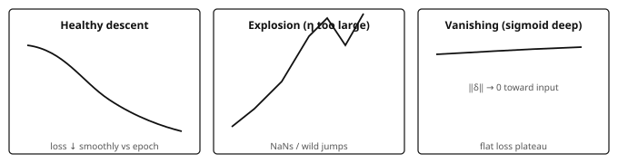
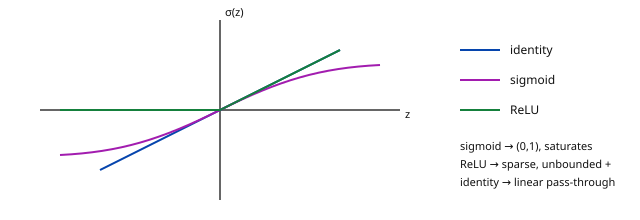
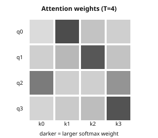

## Introduction and overview {#intro}

[Not in the official curriculum]{.badge .pedagogical} [Independent refresher]{.badge .refresher}

Independent study support, not an official curriculum module or a Deep Learning equivalence. The Year 1 / Period 1 placement is a suggested reading slot. The [reading route](#reading-route) below is a reading recommendation, not an enrolment rule.

### The question this page answers

**What changes between a working affine MNIST classifier and a trainable layered model — and how do shapes, losses and gradients reveal what is happening?**

Start with an observable distinction: scores $(0.5,0.1)$ already predict class 0 by `argmax`, but against the one-hot target $(1,0)$ their MSE is

$$
\frac{(0.5-1)^2+(0.1-0)^2}{2}=0.13.
$$

A gradient step can reduce that loss without changing the predicted class. Loss curves and accuracy answer different questions.

The empirical spine is the public [knoel99/MNIST](https://github.com/knoel99/MNIST) repository: load digits, normalize pixels, flatten, train an affine NumPy classifier with alternative output activations, and inspect loss and accuracy. The calculations below make that path explicit before extending it.

You do not need the notebook to run anything here: [§2.3](#numpy-loop) gives a self-contained NumPy training loop with reference numbers.

::: note
[Starting point]{.tag} The reference notebook trains an **affine MNIST classifier with no hidden layer**, using **MSE and alternative output activations**. The multilayer examples below extend that starting point. They prepare the transition to Deep Learning; they do not replace practice with layered models, automatic differentiation or sequence prediction.
:::

### What you will be able to do

-   Follow the notebook’s data preparation, parameter shapes, scores, MSE, updates and `argmax` evaluation.
-   Distinguish its $(B,784)\to(B,10)$ map from a multilayer extension $(B,784)\to(B,H)\to(B,10)$.
-   Run a complete NumPy training loop for that extension and match its reference loss and accuracy.
-   Compute a tiny forward/backward by hand, including the loss-reduction factor.
-   Compare identity / sigmoid / ReLU through saturation, sparsity and measured loss curves.
-   Read SGD, momentum and Adam updates, then interpret one attention line as a $T\times T$ weight matrix.

Recognizing names such as saturation or exploding gradients helps with diagnosis. **Composing, training and evaluating new layered architectures is additional learning**, not merely a vocabulary change.

### Session plan {#sessions}

**12 h of guided self-study = 6 sessions of 2 h.** This page is off-curriculum: no SynapseS 2026–2027 sheet gives it a volume, so the 12 h is the lower end of the page's own 12–18 h self-study estimate, and the six-session split below is our proposal for a self-study route, not official teaching time. Level 1 = foundations (shapes, definitions, first worked examples), 2 = core methods (backpropagation, activations, optimizers, attention), 3 = advanced material; the level never goes down from one session to the next.

| Session | Hours | Level | Content | Practice |
|---|---|---|---|---|
| 1 | 2 h | 1 | ch. 1 Empirical MNIST path: shapes, MSE helper, what the notebook compares | Ex. 1, 5; positioning task 1 |
| 2 | 2 h | 1 | ch. 2 Tiny $2\to2\to2$ forward, stable softmax, MSE versus cross-entropy, a complete NumPy training loop | run the §2.3 loop; set up Experiment 2.2; positioning task 3 |
| 3 | 2 h | 2 | ch. 3 Backpropagation with numbers: affine MSE table, two-layer ReLU chain | Ex. 2, 3, 6; positioning task 2 |
| 4 | 2 h | 2 | ch. 4 Activations and initialization | Ex. 7 |
| 5 | 2 h | 2 | ch. 5 Optimization in practice: SGD, momentum, Adam | Ex. 8 (write-up of Experiment 2.2) |
| 6 | 2 h | 2 | ch. 6 Attention intuition; ch. 7 exit checkpoint and next steps | Ex. 4; exit checkpoint |

**Self-study, outside the 12 h** (about 6 h in total, optional): full notebook reruns of §1.3 with the GPU/CuPy appendix (≈ 2.5 h) · Experiment 2.2 repeated over several seeds (≈ 1.5 h) · Ex. 7 extended with separate controls for initialization and activation (≈ 1.5 h) · Ex. 5 on a second training run (≈ 0.5 h).

The six sessions cover every chapter; these optional additions bring the total towards the upper end of the 12–18 h estimate.

## Before you start {#before-start}

This page assumes working Python/NumPy and basic matrix multiplication, not prior practice with an MLP or a language model. Use these three tasks to decide where to enter.

| Positioning task | If it is uncertain |
|------------------|--------------------|
| For $B=64$, give the shapes of $X$, $W$, $b$ and $XW+b$ in an affine $784\to10$ classifier. Explain bias broadcasting. | Read [§1.1: notebook shapes](#mnist-scores); use [Refresher CS](../m1p1-refresher-cs/index.html) for implementation foundations. |
| Recover the MSE $0.13$ above and take one parameter update. Which entries does `mean` average? | Work through [§3.1: affine backpropagation and reduction](#affine-backprop). |
| Explain why lower training MSE need not improve held-out accuracy, and why ten sigmoid scores need not sum to one. | Read [§1.3: empirical comparisons](#notebook-comparison) and [§2.2: losses](#losses); revisit [Refresher Statistics](../m1p1-refresher-statistics/index.html) if evaluation concepts are unclear. |

The affine notebook provides practice with normalization, parameter matrices, NumPy updates, loss curves, `argmax` and train/test comparison. It does **not** establish practice with learned hidden representations, autodiff, training/evaluation states, logits-based cross-entropy, or sequences. Tokenization, shifted targets, causal masking and language-model training remain later learning tasks.

## Reading route {#reading-route}

| Your immediate goal | Selective route | Evidence before moving on |
|---------------------|-----------------|---------------------------|
| Check an existing affine MNIST implementation | [§1](#ch1) → [§3.1](#affine-backprop) → [§4](#ch4) | Explain the scores, reproduce Exercise 2, and match the MSE derivative to its reduction. |
| Prepare to enter Deep Learning | [§2](#ch2) → [§3.2](#two-layer-backprop) → [§4.1](#initialization) → [§5](#ch5) | Work Exercises 1, 2, 3 and 6 and report a controlled learning-rate comparison. |
| Get a first attention intuition | [§6](#ch6), after the softmax calculation in §2 | Explain row normalization and solve Exercise 4; no sequence-training claim follows from this alone. |
| Choose the next module | [§7: exit routes](#ch7) | Use the ML, DL or Graph ML route according to the missing skill, rather than reading every refresher in order. |

The full route is an estimate of **about 12–18 hours of self-study**, including exercises and reruns. It is not an official workload or a required duration; the [session plan](#sessions) splits its first 12 h into six sessions of 2 h.

::: {#dl-p2-route .note}
[Route for Deep Learning P2 students]{.tag} On the AI systems route, students take no Deep Learning course in Period 1. The notes of [Deep Learning P2](../m1p2-deep-learning-p2/index.html) list Machine Learning and this refresher as their prerequisites; the official sheet asks for basics in machine learning and Python.

Work ch. 2–6 before DL P2 session 1: sessions 2–6 of the [session plan](#sessions), about 9 h, with Exercises 2, 3, 4 and 6. Read ch. 1 too if positioning task 1 is uncertain.

Attention stops at a single head here. DL P2's [chapter 0](../m1p2-deep-learning-p2/index.html#ch0) completes the step from MLP to transformer block. The [exit checkpoint](#exit-checkpoint) of ch. 7 is your entry check.
:::

## Contents

-   [Introduction and overview](#intro)
-   [Before you start](#before-start)
-   [Reading route](#reading-route)
-   [1. Empirical MNIST path (from the notebook)](#ch1)
-   [2. Forward, loss, training loop — what breaks](#ch2)
-   [3. Gradients and backpropagation with numbers](#ch3)
-   [4. Activations: identity vs sigmoid vs ReLU](#ch4)
-   [5. Optimization in practice (SGD → Adam)](#ch5)
-   [6. Short bridge: attention intuition](#ch6)
-   [7. Connections, limits and exit routes](#ch7)
-   [Exercises](#ex)
-   [Projects and assessment](#projects)
-   [Sources, scope and references](#refs)

## 1. Empirical MNIST path (from the notebook) {#ch1}

Starting point: `MNIST_from_scratch.ipynb` ([public repository](https://github.com/knoel99/MNIST)). The notebook trains a **single affine map** $784\to10$ with a choice of output activation and **MSE** against one-hot labels, not cross-entropy. Below: that path in notes form, then a separate multilayer extension with fully expanded numbers.

### 1.1. Digits → flatten → scores {#mnist-scores}

{fig-alt="MNIST dimensions: the reference notebook has an affine map with no hidden layer; hidden layers and the logit/softmax head belong to the extension." width="100%"}

Keep the two readings separate:

| Path | Computation | Training / prediction |
|------|-------------|-----------------------|
| **Reference notebook: no hidden layer** | pixels → flatten → affine map → optional identity / sigmoid / ReLU output activation → **scores** | MSE against one-hot labels / `argmax` of scores |
| **Multilayer classification extension** | pixels → flatten → affine + hidden nonlinearity → affine classifier → **logits** | softmax cross-entropy / `argmax` of logits or softmax probabilities |

1.  Load CSV rows: label in column 0, pixels in the rest; reshape a row to $28\times28$ for visualization (`imshow`, grayscale).
2.  Features: $X\in\mathbb{R}^{n\times784}$, scaled to $[0,1]$ by `/255.0`.
3.  Targets: one-hot $Y\in\{0,1\}^{n\times10}$.
4.  Notebook model, with $W\in\mathbb{R}^{784\times10}$ and $b\in\mathbb{R}^{1\times10}$:
    $$
    z=XW+b, \qquad \hat y=\phi(z), \quad \phi\in\{\mathrm{id},\sigma,\mathrm{ReLU}\} \text{ applied entrywise.}
    $$
    Identity means no additional output nonlinearity; the sigmoid is $\sigma(z)=1/(1+e^{-z})$ and $\mathrm{ReLU}(z)=\max(z,0)$ (both are compared in chapter 4).
5.  Loss: $\mathrm{MSE}=\mathrm{mean}\big((\hat y-Y)^2\big)$; the notebook comparison uses about 1000 epochs and $\eta=0.01$.
6.  Prediction: $\hat c_i=\arg\max_k\hat y_{ik}$; compare with the integer labels to compute accuracy.

The outputs $\hat y$ are **scores**, not necessarily logits or a probability distribution. Sigmoid bounds each score in $(0,1)$ but does not make a row sum to one. `argmax` does not require normalized probabilities.

Here $n$ is the number of examples in a dataset, $B$ the mini-batch size, and $C=10$ the number of classes. Notebook shapes for one mini-batch:

| Tensor | Shape | Role |
|--------|-------|------|
| $X$ | $(B,784)$ | flattened, normalized pixels |
| $W$ | $(784,10)$ | affine classifier weights |
| $b$ | $(1,10)$ | bias broadcast across the batch |
| $z=XW+b$ | $(B,10)$ | pre-activation outputs |
| $\hat y=\phi(z)$ | $(B,10)$ | scores used by MSE and `argmax` |
| $Y$ | $(B,10)$ | one-hot targets |

::: note
[Shape convention]{.tag} These notes put one example per row: $z=XW+b$, with $W$ of shape (fan-in, fan-out), here $(784,10)$. PyTorch's `nn.Linear` stores its `weight` as (fan-out, fan-in), so our $W$ is `nn.Linear.weight` transposed.

Other LLGA pages write one example as a column, $h=Wx+b$ with $W\in\mathbb{R}^{d_\text{out}\times d_\text{in}}$. Transpose $W$ when you move between the two forms.
:::

For comparison, the **multilayer extension** used later has hidden width $H$:

| Tensor | Shape | Role |
|--------|-------|------|
| $X$ | $(B,784)$ | flattened pixels |
| $W^{(1)}$ | $(784,H)$ | first affine map |
| $b^{(1)}$ | $(1,H)$ | hidden bias |
| $z^{(1)}$ | $(B,H)$ | hidden pre-activations |
| $h$ | $(B,H)$ | hidden representation after $\phi$ |
| $W^{(2)}$ | $(H,10)$ | classifier weights |
| $b^{(2)}$ | $(1,10)$ | classifier bias |
| $z^{(2)}$ | $(B,10)$ | logits for the CE head |
| $\hat p$ | $(B,10)$ | softmax probabilities |

The notebook itself has **no $H$ and no hidden layer**. Depth comes in §2–3 with a tiny $2\to2\to2$ network.

~~~python
# Notebook data shapes after load / normalize / one-hot:
# X_train: (n, 784), y_train: (n, 10)
print(X_train.shape, y_train.shape)  # e.g. (60000, 784), (60000, 10)
~~~

::: note
[Two independent changes]{.tag} Adding hidden layers and switching from MSE to cross-entropy are separate modelling choices. An affine classifier can use cross-entropy; a multilayer network can use MSE. The worked extension below changes both so that their roles can be examined explicitly.
:::

### 1.2. MSE helper and the training skeleton

~~~python
import numpy as np

def mean_squared_error(y_true, y_pred):
    return np.mean(np.square(y_true - y_pred))

def sigmoid(z):
    return 1.0 / (1.0 + np.exp(-z))

def relu(z):
    return np.maximum(z, 0.0)

# One forward step: affine map, no hidden layer.
def forward_linear(X, W, b, activation="identity"):
    z = X @ W + b                       # (B, 10)
    if activation == "sigmoid":
        return sigmoid(z), z
    if activation == "relu":
        return relu(z), z
    return z, z                         # identity
~~~

The training loop repeatedly computes scores, evaluates MSE, differentiates through the selected output activation, and updates $W$ and $b$. [§3.1](#affine-backprop) writes those derivatives with an explicit reduction convention.

Optional: after training, the notebook can `np.save` weights. Reading them back is a useful “what did training produce?” check:

~~~python
W = np.load("identity_weights.npy")   # expected (784, 10)
b = np.load("identity_biases.npy")    # expected (1, 10)
print(W.shape, b.shape, W.mean(), b.ravel()[:3])
~~~

### 1.3. What the notebook compares empirically {#notebook-comparison}

Three configurations, same data, 1000 epochs, $\eta=0.01$:

-   `activation='identity'` — unbounded affine scores; MSE pushes toward $\{0,1\}$ one-hot targets, but nothing clamps the outputs.
-   `activation='sigmoid'` — outputs in $(0,1)$; gradients shrink when $|z|$ is large because $\sigma'(z)=\sigma(z)(1-\sigma(z))\to0$.
-   `activation='relu'` — nonnegative scores, with zero output and zero local derivative for negative pre-activations; an output channel can become inactive across many examples.

The notebook’s plots (`plot_training_insights`, `plot_compare_loss`, accuracy-over-test-prefix) make **loss trajectories and test behavior** visible. Read them as evidence for that particular setup, not as a universal ranking of activations or a fixed MNIST accuracy claim. A brief GPU/CuPy appendix is optional acceleration, not the conceptual core.

For a controlled rerun, record the seed, initialization, batch size, loss reduction and split. Use a validation set to select hyperparameters; keep the test set for final reporting rather than repeatedly selecting settings from test-prefix plots.

::: note
[independent note]{.tag} Softmax cross-entropy is common for single-label classification in Deep Learning. The notebook’s MSE with per-output activations remains useful for inspecting elementary derivatives. §2 introduces the CE head separately; it does not reinterpret the notebook as a softmax classifier.
:::

## 2. Forward, loss, training loop — what breaks {#ch2}

The notebook has no hidden layer, so it cannot show how a signal passes through a nonlinearity or how two common losses differ. This chapter computes one forward pass of a tiny two-layer network by hand, then compares the notebook's MSE with the cross-entropy used for classification, and ends with an experiment that makes training failures visible.

### 2.1. Tiny numerical forward (2 → 2 → 2) {#tiny-forward}

This is the **multilayer extension**, not the reference notebook architecture.

Take one sample $x=(1.0,\ 0.5)$, a ReLU hidden layer, and affine output logits for a two-class CE head:

$$
W^{(1)} = \begin{pmatrix} 0.3 & -0.2 \\ 0.1 & 0.4 \end{pmatrix},\quad
b^{(1)} = (0.1,\ -0.1),\quad
W^{(2)} = \begin{pmatrix} 0.5 & 0.2 \\ -0.3 & 0.6 \end{pmatrix},\quad
b^{(2)} = (0.0,\ 0.1).
$$

Term-by-term:

$$
\begin{aligned}
z^{(1)}_1 &= 1.0\cdot 0.3 + 0.5\cdot 0.1 + 0.1 = 0.45,\\
z^{(1)}_2 &= 1.0\cdot(-0.2) + 0.5\cdot 0.4 + (-0.1) = -0.1,\\
h &= \mathrm{ReLU}(z^{(1)}) = (0.45,\ 0.0),\\
z^{(2)}_1 &= 0.45\cdot 0.5 + 0\cdot(-0.3) + 0 = 0.225,\\
z^{(2)}_2 &= 0.45\cdot 0.2 + 0\cdot 0.6 + 0.1 = 0.19.
\end{aligned}
$$

Softmax:

$$
e^{0.225}\approx 1.2523,\quad e^{0.19}\approx 1.2092,\quad
\hat p \approx \Big(\frac{1.2523}{2.4615},\ \frac{1.2092}{2.4615}\Big) \approx (0.5087,\ 0.4913).
$$

For target $y=(1,0)$, the cross-entropy is $-\log\hat p_1\approx0.676$. The model predicts the correct class, but only narrowly.

A stable implementation subtracts the largest logit before exponentiation. This leaves softmax unchanged:

~~~python
def softmax(z, axis=-1):
    shifted = z - np.max(z, axis=axis, keepdims=True)
    exp_z = np.exp(shifted)
    return exp_z / np.sum(exp_z, axis=axis, keepdims=True)
~~~

### 2.2. Losses: MSE (notebook) and CE (classification extension) {#losses}

::: def
[Definition 2.1 — Empirical risk]{.tag} For $n$ labelled examples and model parameters $\theta$,
$$
\hat{\mathcal{R}}(\theta) = \frac1n \sum_{i=1}^n \ell\big(f_\theta(x_i), y_i\big).
$$
The per-example loss $\ell$ must specify how output coordinates are reduced.
:::

-   **Notebook MSE:** squared score errors, averaged over all $B\times C$ entries in a batch:
    $$
    \mathcal{L}_{\mathrm{MSE}}=\frac{1}{BC}\sum_{i=1}^{B}\sum_{k=1}^{C}(\hat y_{ik}-Y_{ik})^2.
    $$
-   **Single-label classifier CE:** for one example,
    $$
    \ell_{\mathrm{CE}}=-\sum_k y_k\log\hat p_k,\qquad
    \hat p=\mathrm{softmax}(z),\qquad
    \nabla_z\ell_{\mathrm{CE}}=\hat p-y.
    $$
    Here $z$ denotes logits and $y$ is one-hot. A batch-mean CE introduces a factor $1/B$, not $1/(BC)$.

The score arrays, objectives and gradient scales differ. Compare accuracy under the same evaluation protocol; do not compare the numerical magnitudes of MSE and CE as though they were the same quantity.

In a framework, a fused cross-entropy function commonly accepts **logits** and computes log-softmax internally. Check the API rather than applying softmax twice.

{fig-alt="Three schematic training regimes: healthy descent, explosion, and vanishing gradients." width="100%"}

::: ex
[Experiment 2.2 — controlled learning-rate stress test]{.tag} Choose either the affine notebook model or the two-layer extension; the loop of [§2.3](#numpy-loop) runs the extension without the notebook. Keep that architecture and its loss reduction fixed. Run **5 epochs** for each setting, resetting to the same initialization and mini-batch order:

| Setting | Diagnostic hypothesis to test |
|---------|-------------------------------|
| $\eta=3$ | Large-step stress test: loss may jump, diverge or become non-finite. |
| $\eta=10^{-3}$ | Smaller updates may give slow but stable decrease and look flat early. |
| $\eta=0.01$ (notebook default) | Reference setting for the notebook’s MNIST MSE comparison. |
| Adam, $\mathrm{lr}=10^{-3}$ | Adaptive updates may give a smoother or faster trajectory than SGD at the same nominal learning rate. |

Record loss, accuracy and gradient norms; keep the data split, batch size and reduction visible. These outcomes are **hypotheses, not guaranteed labels**: changing the loss scale can change which learning rate is large.

Write three sentences identifying which observed curve resembles each relevant panel above. Then report what changes when swapping ReLU↔sigmoid at fixed $\eta=0.01$; connect the result to §4. A flat loss alone does not distinguish a tiny step size from saturation.
:::

### 2.3. A complete training loop in NumPy {#numpy-loop}

The notebook is one way to watch training happen. This loop is another, with no external code: it trains the multilayer extension $784\to128\to10$ (ReLU hidden layer, softmax CE head) with mini-batch SGD.

The forward pass is §2.1 at full size. The four backward lines are the batch-mean CE gradients that [§3.2](#two-layer-backprop) derives by hand: run them now, check them there.

~~~python
import numpy as np   # softmax(...) is the stable helper of §2.1

# Keras copy of MNIST (60,000 training and 10,000 test images):
# https://storage.googleapis.com/tensorflow/tf-keras-datasets/mnist.npz
with np.load("mnist.npz") as f:
    X, y = f["x_train"].reshape(-1, 784) / 255.0, f["y_train"]
Xtr, ytr, Xva, yva = X[:55000], y[:55000], X[55000:], y[55000:]  # test set untouched

rng = np.random.default_rng(0)
W1 = rng.normal(0, np.sqrt(2 / 784), size=(784, 128)); b1 = np.zeros((1, 128))
W2 = rng.normal(0, np.sqrt(2 / 128), size=(128, 10));  b2 = np.zeros((1, 10))
eta, B = 0.1, 64

def forward(X):
    z1 = X @ W1 + b1
    h = np.maximum(z1, 0.0)
    return z1, h, softmax(h @ W2 + b2)

for epoch in range(1, 6):
    perm = rng.permutation(len(Xtr))
    for s in range(0, len(Xtr), B):
        idx = perm[s:s + B]
        xb, yb = Xtr[idx], np.eye(10)[ytr[idx]]          # one-hot targets
        z1, h, p = forward(xb)
        delta2 = (p - yb) / len(idx)                      # batch-mean CE, §3.2
        delta1 = (delta2 @ W2.T) * (z1 > 0)               # before W2 changes
        W2 -= eta * h.T @ delta2;  b2 -= eta * delta2.sum(0, keepdims=True)
        W1 -= eta * xb.T @ delta1; b1 -= eta * delta1.sum(0, keepdims=True)
    p_tr = forward(Xtr)[2]
    loss = -np.mean(np.log(p_tr[np.arange(len(ytr)), ytr]))
    acc = np.mean(forward(Xva)[2].argmax(axis=1) == yva)
    print(f"epoch {epoch}: train CE {loss:.4f}, validation accuracy {acc:.4f}")
~~~

Reference output with seed 0, float64 NumPy and this file:

| After | Training CE (55,000 images) | Validation accuracy (5,000 images) |
|---|---|---|
| epoch 1 | 0.2340 | 0.9486 |
| epoch 5 | 0.0883 | 0.9762 |

The training CE is measured on the whole training split after the epoch, not averaged over its mini-batches. Your digits should agree to about three decimals; another seed, batch order or copy of the data changes them.

These are validation numbers: the 10,000 test images stay free for one final report. To compare with the notebook's affine MSE model, train it on the same split and read its validation accuracy.

## 3. Gradients and backpropagation with numbers {#ch3}

Training needs the derivative of the loss with respect to every weight and bias. This chapter writes those derivatives for the notebook's affine model, checks them on a numerical example, and then chains them backward through the two-layer network of chapter 2.

### 3.1. One-layer backprop table (notebook algebra) {#affine-backprop}

For $\hat y=\phi(XW+b)$ and $\mathcal{L}=\mathrm{mean}((\hat y-Y)^2)$, let $Y$ contain $B\times C$ entries. Then $|Y|=BC$ and

$$
\frac{\partial\mathcal{L}}{\partial \hat y}
=\frac{2}{BC}(\hat y-Y).
$$

The output activation adds its local derivative:

$$
\frac{\partial\mathcal{L}}{\partial z} = \underbrace{\frac{2}{|Y|}(\hat y-Y)}_{\text{d\_loss}} \odot \phi'(z),\qquad
\frac{\partial\mathcal{L}}{\partial W} = X^\top \frac{\partial\mathcal{L}}{\partial z},\qquad
\frac{\partial\mathcal{L}}{\partial b} = \sum_{\text{batch}} \frac{\partial\mathcal{L}}{\partial z}.
$$

Here $\odot$ is entrywise multiplication. The bias gradient sums over examples because the same bias was broadcast to every row. The averaging is already included in `d_loss`; do not divide by $B$ again when computing $dW$ or $db$.

::: note
[Reduction check, not a bug report]{.tag} For $B=64$ and $C=10$, the prediction-gradient factor is $2/640=0.003125$. A sample mean of **class-summed** squared errors would instead use $2/B$, ten times larger here. Check the full training method against the loss it reports before comparing learning rates. A truncated training-method excerpt does not establish an implementation mismatch: this is a verification to perform, not a confirmed bug in the repository.
:::

Concrete componentwise numbers: batch size 1, two outputs. Let $x=(1,\ 0)$,

$$
W=\begin{pmatrix}0.5&0.1\\0.2&-0.4\end{pmatrix},\qquad
b=(0,0),\qquad
\phi=\mathrm{id},\qquad
y=(1,0).
$$

| Step | Value |
|------|-------|
| $z=xW+b$ | $(0.5,\ 0.1)$ |
| $\hat y=\phi(z)$ | $(0.5,\ 0.1)$ |
| $\hat y-y$ | $(-0.5,\ 0.1)$ |
| $\mathcal{L}=\mathrm{mean}((\hat y-y)^2)$ | $0.13$ |
| $d_z=2/2\,(\hat y-y)$ | $(-0.5,\ 0.1)$ |
| $dW=x^\top d_z$ | $\begin{pmatrix}-0.5&0.1\\0&0\end{pmatrix}$ |
| $db=d_z$ | $(-0.5,\ 0.1)$ |
| update $W\leftarrow W-\eta\,dW$ ($\eta=0.01$) | $\begin{pmatrix}0.505&0.099\\0.2&-0.4\end{pmatrix}$ |
| update $b\leftarrow b-\eta\,db$ | $(0.005,\ -0.001)$ |

After updating **both** $W$ and $b$, the scores become $(0.510,\ 0.098)$ and the MSE becomes

$$
\frac{(-0.490)^2+(0.098)^2}{2}=0.124852.
$$

The loss decreased, while `argmax` stayed on class 0.

With **sigmoid**, first recompute $\hat y=\sigma(z)$: the residual changes too. Then multiply the prediction gradient by $\sigma'(z)=\sigma(z)(1-\sigma(z))$ entrywise before the $X^\top$ product. This is where saturation attenuates the update.

A NumPy backward helper matching the stated all-entry mean:

~~~python
def backward_affine_mse(X, Y, scores, z, activation="identity"):
    d_scores = 2.0 * (scores - Y) / Y.size
    if activation == "sigmoid":
        dz = d_scores * scores * (1.0 - scores)
    elif activation == "relu":
        dz = d_scores * (z > 0)
    else:
        dz = d_scores
    dW = X.T @ dz
    db = np.sum(dz, axis=0, keepdims=True)
    return dW, db
~~~

This helper specifies the convention used in these notes; it is not a transcription of the repository’s complete trainer.

### 3.2. Two-layer chain (ReLU) with the §2.1 numbers {#two-layer-backprop}

Return to the **multilayer CE extension**. For one-hot target $y=(1,0)$,

$$
\delta^{(2)}=\hat p-y\approx(-0.4913,\ 0.4913).
$$

The output-layer derivative and the chain back to the hidden layer are

$$
\begin{aligned}
\nabla_{W^{(2)}}\mathcal{L} &= h^\top \delta^{(2)}
  = \begin{pmatrix}0.45\\0\end{pmatrix}\begin{pmatrix}-0.4913&0.4913\end{pmatrix}
  = \begin{pmatrix}-0.2211&0.2211\\0&0\end{pmatrix},\\
\delta^{(1)} &= \big(\delta^{(2)} (W^{(2)})^\top\big)\odot \mathbf{1}_{z^{(1)}>0}
  = \big((-0.4913,\ 0.4913)\,(W^{(2)})^\top\big)\odot(1,0).
\end{aligned}
$$

Using the rounded values, compute $\delta^{(2)}(W^{(2)})^\top$:

$$
(-0.4913,\ 0.4913)
\begin{pmatrix}0.5 & -0.3 \\ 0.2 & 0.6\end{pmatrix}
\approx
(-0.1474,\ 0.4422).
$$

Apply the ReLU mask $(1,0)$ to obtain $\delta^{(1)}\approx(-0.1474,\ 0)$. Then

$$
\nabla_{W^{(1)}}\mathcal{L}
=x^\top\delta^{(1)}
\approx
\begin{pmatrix}
-0.1474&0\\
-0.0737&0
\end{pmatrix}.
$$

For this one-example calculation, $\nabla_{b^{(2)}}\mathcal{L}=\delta^{(2)}$ and $\nabla_{b^{(1)}}\mathcal{L}=\delta^{(1)}$. The second hidden unit contributes no weight gradient for this sample because its ReLU is inactive.

Batch-mean CE version:

~~~python
# x: (B, 2), h and z1: (B, 2), p and y_onehot: (B, 2)
B = x.shape[0]
delta2 = (p - y_onehot) / B
dW2 = h.T @ delta2
db2 = delta2.sum(axis=0, keepdims=True)
delta1 = (delta2 @ W2.T) * (z1 > 0)   # ReLU'
dW1 = x.T @ delta1
db1 = delta1.sum(axis=0, keepdims=True)
~~~

Compute the whole backward pass with the weights used in the forward pass, then update the parameters. Updating $W^{(2)}$ before computing $\delta^{(1)}$ would mix two parameter states.

::: note
[Computation graph]{.tag} The computation graph is a DAG; backpropagation applies vector–Jacobian products in reverse topological order. A useful debugging question is: which operation multiplies this gradient by nearly zero? This graph of computational dependencies is not the relational data graph studied in Graph ML.
:::

## 4. Activations: identity vs sigmoid vs ReLU {#ch4}

The choice of activation decides how large the local derivatives of chapter 3 can be, and therefore whether updates stay useful or fade away. This chapter compares identity, sigmoid and ReLU, explains why a hidden nonlinearity is needed at all, and shows how the scale of the initial weights interacts with saturation.

{fig-alt="Identity, sigmoid and ReLU activation curves, with output use in the notebook distinguished from hidden-layer use in the extension." width="100%"}

::: def
[Definition 4.1 — Common activations]{.tag} The three activations and their derivatives are
$$
\begin{aligned}
\mathrm{ReLU}(z)&=\max(z,0), & \mathrm{ReLU}'&=\mathbf{1}_{z>0},\\
\sigma(z)&=(1+e^{-z})^{-1}, & \sigma'&=\sigma(1-\sigma),\\
\mathrm{id}(z)&=z, & \mathrm{id}'&=1.
\end{aligned}
$$
At the ReLU kink $z=0$, the code uses derivative 0.
:::

Qualitative map to the notebook ([MNIST_from_scratch](https://github.com/knoel99/MNIST)):

| Activation | Curve behavior | Training symptom to watch |
|------------|----------------|---------------------------|
| identity | linear activation | affine output scores are not bounded; MSE is still defined |
| sigmoid | nearly flat for $\lvert z\rvert\gg1$ | slow updates when saturated; loss may stall |
| ReLU | zero on negative inputs | sparse output activity in the notebook, or hidden activity in an extension; inactive channels if pre-activations stay nonpositive |

`plot_training_insights` also tracks selected pixel→class weights over epochs — useful for checking whether learning concentrates on stroke pixels near the center rather than background corners. Prefer the notebook’s own loss/accuracy figures over memorized percentages; rerun locally if a number is needed for a report.

Output activation and hidden nonlinearity have different roles. Stacking affine maps with **identity hidden activations** still gives a single affine map:

$$
(XW^{(1)}+b^{(1)})W^{(2)}+b^{(2)}
=
X(W^{(1)}W^{(2)})+(b^{(1)}W^{(2)}+b^{(2)}).
$$

A hidden nonlinearity prevents this collapse and allows a richer representation. Learning to train that representation is an extension beyond choosing an activation on the notebook’s ten outputs.

### 4.1. Initialization {#initialization}

If $W_{ij}\sim\mathcal{N}(0,1)$, pre-activation variance can grow with fan-in. For zero-mean weights drawn independently of the inputs,

$$
\mathrm{Var}(z_j)\approx \mathrm{fan\_in}\,\mathrm{Var}(W_{ij})\,\mathbb{E}[x_i^2],
$$

where $\mathbb{E}[x_i^2]$ is the second moment of an input, averaged over the inputs.

With standardized inputs, $\mathbb{E}[x_i^2]=1$: at fan-in 784, unit-variance weights give variance 784, or standard deviation 28. The notebook only scales pixels to $[0,1]$, and MNIST then has $\mathbb{E}[x_i^2]\approx0.11$: the variance is about 88 and the standard deviation about 9.4. Either scale pushes many sigmoid outputs into saturation.

Common scale choices:

-   **He** for ReLU: $\mathrm{Var}(W_{ij})=2/\mathrm{fan\_in}$.
-   **Xavier** for tanh/sigmoid: $\mathrm{Var}(W_{ij})=1/\mathrm{fan\_in}$, or $2/(\mathrm{fan\_in}+\mathrm{fan\_out})$.

~~~python
rng = np.random.default_rng(0)
W1 = rng.normal(0, np.sqrt(2 / 784), size=(784, 128))  # He for ReLU
W2 = rng.normal(0, np.sqrt(2 / 128), size=(128, 10))   # illustrative head scale
~~~

The second line is an illustrative classifier initialization, not a rule that every affine output head requires He scaling. These variance arguments control initial scale under assumptions; they do not guarantee healthy gradients throughout a deep model.

## 5. Optimization in practice (SGD → Adam) {#ch5}

Once gradients are correct, the remaining question is how to turn them into parameter updates. This chapter states mini-batch SGD, then adds momentum and Adam, reading each hyperparameter and piece of optimizer state literally.

::: def
[Definition 5.1 — Mini-batch SGD]{.tag}
$$
\theta_{t+1} = \theta_t - \eta \nabla_\theta \hat{\mathcal{R}}_{B_t}(\theta_t).
$$
Here $B_t$ is the set of examples in the current mini-batch, $\theta$ contains all weights and biases, and the batch loss uses the declared reduction.
:::

**Momentum** accumulates a velocity. Writing $g_t$ for the current gradient,

$$
v_{\mathrm{mom}}\leftarrow\beta v_{\mathrm{mom}}+g_t,\qquad
\theta\leftarrow\theta-\eta v_{\mathrm{mom}}.
$$

The momentum coefficient $\beta$ is often 0.9.

**Adam** maintains first and second moments with bias correction. It is a useful default once shapes and derivatives are trusted, but it does not remove the need to choose a learning rate or inspect loss scaling.

~~~python
def adam(param, grad, m, v, t, lr=1e-3, beta1=0.9, beta2=0.999, eps=1e-8):
    m = beta1 * m + (1 - beta1) * grad
    v = beta2 * v + (1 - beta2) * (grad * grad)
    mhat = m / (1 - beta1 ** t)
    vhat = v / (1 - beta2 ** t)
    return param - lr * mhat / (np.sqrt(vhat) + eps), m, v
~~~

Read the state and hyperparameters literally:

-   `lr` is the step-size multiplier.
-   `beta1` controls smoothing of the gradient; `beta2` controls smoothing of its elementwise square.
-   `m` and `v` are persistent, parameter-shaped states. Adam’s `v` is a second-moment estimate, not the momentum velocity above.
-   `t` starts at 1 and counts optimizer steps; use the same step number for all parameters updated together.
-   `eps` protects the denominator; it is not a general cure for unstable training.

Initialize `m` and `v` to zero for each parameter, retain the returned states between steps, and reset them between independent experimental runs. Return to Experiment 2.2 to compare observed behavior rather than assuming Adam must win.

## 6. Short bridge: attention intuition {#ch6}

Goal: **not** to train an LLM. Only see how attention creates a $T\times T$ pattern of weights and uses it to mix values.

For example, a row of weights $(0.1,0.2,0.6,0.1)$ produces the weighted combination $0.1V_0+0.2V_1+0.6V_2+0.1V_3$. The third position contributes most; the weights in that row sum to one.

Let $T$ be the number of positions, $d_k$ the query/key dimension, and $d_v$ the value dimension:

$$
Q,K\in\mathbb{R}^{T\times d_k},\qquad
V\in\mathbb{R}^{T\times d_v}.
$$

::: def
[Definition 6.1 — Attention (single head)]{.tag}
$$
\mathrm{Attention}(Q,K,V)=\mathrm{softmax}\Big(\frac{QK^\top}{\sqrt{d_k}}\Big)V.
$$
Softmax acts across key positions in each row. The weight matrix has shape $(T,T)$ and the output has shape $(T,d_v)$.
:::

{fig-alt="A schematic 4 by 4 attention heatmap showing weights across positions." width="60%"}

Using the stable row-wise softmax helper from §2:

~~~python
def attention(Q, K, V):
    d_k = Q.shape[1]
    scores = (Q @ K.T) / np.sqrt(d_k)   # (T, T)
    weights = softmax(scores, axis=-1)
    return weights @ V, weights
~~~

*Preview, taught in [Deep Learning §6.2](../m1p1-deep-learning/index.html#ch6) (or chapter 0 of [Deep Learning P2](../m1p2-deep-learning-p2/index.html#ch0)).* A common **pre-normalized** transformer block is approximately LayerNorm → attention → residual → LayerNorm → MLP → residual. There, $Q=XW_Q$ is learned from token rows $X\in\mathbb{R}^{T\times d}$, and $h$ heads use $d_k=d/h$. Learned projections, multiple heads, batching and these surrounding operations require further practice in Deep Learning.

*Preview, taught in [Text Mining and NLP](../m1p2-nlp-text-mining/index.html#ch1) (tokenization in §1.2).* Token prediction uses the same CE family as classification, but adds a sequence task: tokenization, per-position targets, target shifting, causal masking and sequence evaluation. None of those is supplied by the affine MNIST notebook or by this attention function.

Attention provides an intuition for weighted aggregation. Whether an explicit relational graph improves a text model is a separate empirical question — central to the Graph × LLM reading route, not answered by an attention heatmap.

## 7. Connections, limits and exit routes {#ch7}

The following is a **reading recommendation**, not a statement of official prerequisites, elective status or curriculum equivalence.

### Exit checkpoint {#exit-checkpoint}

Before leaving for layered-model work, check that you can:

1.  Separate **notebook scores → MSE / `argmax`** from **extension logits → softmax CE**, and explain the $2/(BC)$ MSE factor: [§1.1](#mnist-scores), [§2.2](#losses), [§3.1](#affine-backprop), Exercise 2.
2.  Reproduce the tiny forward and hidden ReLU mask, with correctly shaped gradients: [§2.1](#tiny-forward), [§3.2](#two-layer-backprop), Exercises 1, 2, 3 and 6.
3.  Report a controlled learning-rate comparison without inferring generalization from training loss alone: [§1.3](#notebook-comparison), [Experiment 2.2](#losses), [§2.3](#numpy-loop), Exercise 8.
4.  Read one attention row as weights over key positions, with and without a causal mask: [§6](#ch6), Exercise 4.

These are **entry checks for further study**, not evidence of completing Deep Learning.

For a student entering [Deep Learning P2](../m1p2-deep-learning-p2/index.html) without the Period 1 course, checks 1–4 are the entry check for its session 1 (see the [DL P2 route](#dl-p2-route)). Its chapter 0 starts from check 4 and completes the transformer block.

| Reading stage | Exit destination and purpose | What this refresher supplies — and what remains |
|---------------|-----------------------------|------------------------------------------------|
| Refreshers on demand | [Refresher Statistics](../m1p1-refresher-statistics/index.html) · [Refresher CS](../m1p1-refresher-cs/index.html) | Revisit uncertainty, evaluation or implementation only where the positioning tasks expose a gap. Neither refresher is assumed complete. |
| Evaluation first | [Machine Learning](../m1p1-machine-learning/index.html) | Carry empirical risk and a reproducible affine baseline. Develop validation, regularization, model comparison and leakage controls. |
| Layered models next | [Deep Learning — continue from manual gradients to trained representations](../m1p1-deep-learning/index.html) · on the AI systems route, [Deep Learning P2](../m1p2-deep-learning-p2/index.html) | Carry the two-layer calculation and optimizer diagnostics. Implement and evaluate layered models with autodiff, training/evaluation states and appropriate architectures. |
| Relational branch | [Graph ML](../m1p2-graph-ml/index.html) | Carry batched affine maps, nonlinear composition and gradient checks. Learn data-graph representations, message passing, relational splits and feature-only baselines. |
| Text branch, coordinated with Graph ML | [Text Mining and NLP](../m1p2-nlp-text-mining/index.html) | Carry softmax/CE and the optional attention intuition. Learn text representations, tokenization, sequence targets and sequence evaluation. |
| Graph × LLM continuation | [Large Language Models](../m2-large-language-models/index.html) · [Advanced GNN](../m2-advanced-gnn/index.html) | Build on the two branches before evaluating coupling choices, graph expressivity, scaling and language-model objectives. This refresher is not a direct substitute for those steps. |

For a concrete **next Deep Learning experiment**, implement the $2\to2\to2$ example with automatic differentiation and compare its gradients to §3.2 before scaling up. Then train a hidden-layer MNIST model under a fixed split and compare it with the affine baseline. Reproduce the computation first; ask whether the added representation improves held-out results second.

For **Graph ML**, keep the same discipline: compare a feature-only baseline with relational aggregation under an appropriate fixed split. A graph can introduce leakage or complexity without adding predictive signal. Later Graph × LLM work should test whether relational information improves over a text-only baseline, including cases where it does not.

Optimal Transport and Geometric DL can provide complementary tools when the problem calls for them. OT, TDA and RL are not universal prerequisites for LLMs, privacy or tool-using agents. Further graph-generation, engineering and security reading should be selected around the system being evaluated. Internship, transverse and exit pages serve as places to synthesize independent work proposals, not as obligations created by this refresher.

::: recap
[Recap]{.tag} The empirical spine is **digits → flatten → affine map → optional output activation → scores → MSE training / `argmax` evaluation**. The expanded multilayer forward/backward and attention heatmap extend that starting point. Use the checkpoints to enter ML, DL or Graph ML selectively; continue practising layered models, autodiff and sequences rather than treating this on-ramp as their replacement.
:::

## Exercises {#ex}

1.  **★ MNIST shapes.** For $B=64$, $H=256$, write shapes of $x,W^{(1)},z^{(1)},h,W^{(2)},\hat p$ and the FLOPs order of magnitude for one forward in the **multilayer extension**. Contrast this with the affine notebook model.

    ::: sol
    $x:(64,784)$, $W^{(1)}:(784,256)$, $z^{(1)},h:(64,256)$, $W^{(2)}:(256,10)$, $\hat p:(64,10)$.

    The dominant cost is
    $$
    64\cdot(784\cdot256+256\cdot10)
    \approx1.3\cdot10^7
    $$
    multiply-adds, or about $2.6\cdot10^7$ FLOPs if a multiplication and an addition count separately.

    The notebook instead uses $W:(784,10)$, $b:(1,10)$ and scores $(64,10)$, with no hidden tensor. Its dominant affine cost is $64\cdot784\cdot10=501{,}760$ multiply-adds. Bias additions and activation costs are smaller here.
    :::

2.  **★ Numerical one-layer step.** Take the identity activation and
    $$
    x=(1,0), \quad W=\begin{pmatrix}0.5&0.1\\0.2&-0.4\end{pmatrix}, \quad b=(0,0), \quad y=(1,0), \quad \eta=0.01 .
    $$
    Recompute the updated $W$ from §3.1. State the MSE reduction. What prediction-gradient factor would an all-entry mean use for $B=64$, $C=10$?

    ::: sol
    Here $B=1$, $C=2$, so
    $$
    d_z=\frac{2}{2}(-0.5,0.1)=(-0.5,0.1),\qquad
    dW=\begin{pmatrix}-0.5&0.1\\0&0\end{pmatrix}.
    $$
    Thus
    $$
    W\leftarrow\begin{pmatrix}0.505&0.099\\0.2&-0.4\end{pmatrix}.
    $$
    The loss averages over both output entries. If the bias is updated too, $b\leftarrow(0.005,-0.001)$.

    For $B=64$, $C=10$, the factor is $2/(BC)=2/640=0.003125$. It is already included before multiplying by $X^\top$.
    :::

3.  **★ Hand backprop (scalar).** $y=\sigma(w_2\sigma(w_1x))$, $\mathcal{L}=\tfrac12(y-t)^2$, at $x=1,t=0,w_1=w_2=1$. Compute $\partial\mathcal{L}/\partial w_1$ and $\partial\mathcal{L}/\partial w_2$.

    ::: sol
    Let $h=\sigma(w_1x)\approx0.7311$, so $y=\sigma(w_2h)\approx0.675$.

    $$
    \frac{\partial\mathcal{L}}{\partial w_2}
    =(y-t)y(1-y)h\approx0.108,
    $$
    $$
    \frac{\partial\mathcal{L}}{\partial w_1}
    =(y-t)y(1-y)w_2h(1-h)x\approx0.029.
    $$

    The extra local derivative $h(1-h)$ explains why the first weight receives a smaller gradient in this example.
    :::

4.  **★ Toy attention.** $T=5$, $d_k=16$; force $K_2$ to align positively with $Q_0$ and make its score larger than the other scores. Check that row 0 of the weights concentrates on column 2. Would that connection be allowed under a causal mask?

    ::: sol
    A large score $(Q_0\cdot K_2)/\sqrt{d_k}$ dominates its softmax row. Alignment alone is insufficient if other keys have still larger dot products.

    For example, if the five row scores are $(0,0,5,0,0)$, then
    $$
    A_{0,2}=\frac{e^5}{e^5+4}\approx0.9738.
    $$
    Under a causal mask, query position 0 cannot attend to future position 2, so that weight would be zero. The helper in §6 is unmasked attention, not a complete autoregressive model.
    :::

5.  **★ (Optional)** Load saved `*_weights.npy` from a notebook run; print norms per output column. Which digit class has the largest $\|W_{:,k}\|$?

    ::: sol
    For $W$ of shape $(784,10)$:

    ~~~python
    column_norms = np.linalg.norm(W, axis=0)
    print(column_norms)
    print("Largest-norm output column:", np.argmax(column_norms))
    ~~~

    The ranking depends on the run; the exercise is the measurement protocol, not a fixed answer. A larger column norm does not by itself establish better class accuracy or calibration.
    :::
6.  **★★ Softmax-CE gradient.** Show $\nabla_z\ell=p-y$ for one-hot $y$; check with finite differences on a 3-vector.

    ::: sol
    With $p=\mathrm{softmax}(z)$,
    $$
    \frac{\partial p_k}{\partial z_j}=p_k(\mathbf{1}_{k=j}-p_j).
    $$
    Direct differentiation gives
    $$
    \frac{\partial\ell}{\partial z_j}
    =-\sum_k y_k(\mathbf{1}_{k=j}-p_j)
    =-y_j+p_j\sum_k y_k
    =p_j-y_j.
    $$

    For $z=(0.2,-0.1,0.4)$ and $y=(0,0,1)$,
    $$
    p\approx(0.337585,\ 0.250089,\ 0.412327),\qquad
    \nabla_z\ell\approx(0.337585,\ 0.250089,\ -0.587673).
    $$

    ~~~python
    z = np.array([0.2, -0.1, 0.4], dtype=float)
    y = np.array([0.0, 0.0, 1.0])

    def ce_from_logits(z, y):
        shifted = z - np.max(z)
        log_p = shifted - np.log(np.exp(shifted).sum())
        return -np.sum(y * log_p)

    eps = 1e-5
    finite_difference = np.zeros_like(z)
    for j in range(z.size):
        step = np.zeros_like(z)
        step[j] = eps
        finite_difference[j] = (
            ce_from_logits(z + step, y) - ce_from_logits(z - step, y)
        ) / (2 * eps)

    analytic = softmax(z) - y
    print(analytic, finite_difference)
    print(np.allclose(analytic, finite_difference, atol=1e-7))
    ~~~

    This is one example. For a batch-mean CE, divide each example’s logit gradient by $B$.
    :::

7.  **★★ Saturation.** Use a bad $\mathcal{N}(0,1)$ initialization with sigmoid on a deep stack; then try He initialization with ReLU. Report whether $\|\delta^{(\ell)}\|$ recovers across layers. Keep the data and widths fixed.

    ::: sol
    Large pre-activation variance can saturate $\sigma$, making its derivative nearly zero. He scaling with ReLU aims to control activation variance and retain nonzero local derivatives on a positive fraction of units.

    Gradient norms may improve, but recovery is not guaranteed at every depth or learning rate. Plot norms by layer rather than declaring the issue fixed. This comparison changes both initialization and activation; separate controls are needed to attribute the improvement to either one alone.
    :::

8.  **★★ Experiment 2.2 write-up.** Attach the three stress-test loss curves ($\eta=3$, $10^{-3}$, Adam $10^{-3}$), and keep the $\eta=0.01$ notebook baseline for context. Label observed explosion / slow descent / smooth descent only where the measurements support those descriptions.

    ::: sol
    Compare the curves with `schema-grad-regimes.svg`. Report the architecture, seed, batch size, reduction and split alongside them.

    Adam may produce smoother early progress than SGD at the same nominal learning rate, but this is not guaranteed. If $\eta=3$ remains stable, report that result rather than forcing an “explosion” label. If a curve is flat, use gradient norms and activation statistics to distinguish small steps from saturation. Five epochs are a diagnostic window, not a generalization study.
    :::

## Projects and assessment {#projects}

Official assessment: not displayed. This refresher is outside the official curriculum, so no SynapseS sheet gives it an assessment, and the subjects below are **proposals** for self-assessment. They are also the remediation route for AI systems students before [Deep Learning P2](../m1p2-deep-learning-p2/index.html). The NumPy MLP is the "from scratch" reflex that [Deep Learning](../m1p1-deep-learning/index.html) ch. 2 and DL P2 ch. 0 reuse. The projects exercise objective **O1** (ML and DL foundations) only.

### Solo projects {#projects-solo}

1.  **[Solo · ≈ 10 h] From affine scores to a trained MLP in pure NumPy.** Question: how much of the gain over the affine MSE baseline comes from the hidden layer, and how much from the change of loss (the "Two independent changes" note of §1.1)?
    -   *Implement*: a 2 × 2 design {affine, one hidden ReLU layer of width 128} × {MSE, softmax CE}, built on the [§2.3](#numpy-loop) loop; finite-difference checks of every gradient on a batch of 8, as in Exercise 6.
    -   *Data*: MNIST (LeCun, Cortes and Burges), the Keras `mnist.npz` copy; the §2.3 split, with the 10,000 test images used once.
    -   *Deliverables*: script, 4-page report, table of test accuracy (mean ± standard deviation over 3 seeds) for the four cells.
    -   *Chapters*: ch. 1, 2, 3, 5.
    -   *Success*: every gradient check below $10^{-6}$ relative error; one learning rate per cell chosen on validation; a report that separates the depth effect from the loss effect.
2.  **[Solo · ≈ 10 h] Gradient-flow lab: a paper study of Glorot and Bengio (2010).** Reproduce on MNIST the per-layer activation and gradient statistics of X. Glorot and Y. Bengio, "Understanding the difficulty of training deep feedforward neural networks", AISTATS 2010, and extend them to ReLU with the He scale (He, Zhang, Ren and Sun, ICCV 2015).
    -   *Implement*: a factorial design {sigmoid, ReLU} × {$\mathcal{N}(0,1)$, Xavier, He} on 5 hidden layers of width 256; the general $L$-layer $\delta$ recursion behind §3.2; per-layer activation second moment, gradient norm and dead-ReLU fraction, at initialization and after one epoch.
    -   *Deliverables*: script, per-layer plots, 4-page report comparing measured and predicted variances.
    -   *Chapters*: ch. 3, 4.
    -   *Success*: averaged over 3 seeds, the layer-1 mean of $z^2$ matches the [§4.1](#initialization) prediction within 10 %; initialization and activation effects are attributed separately, the control that Exercise 7 lacks.
3.  **[Solo · ≈ 8 h] Attention from scratch on a toy retrieval task.** Question: can one causal attention head learn to fetch the token two positions back, and does its $T\times T$ weight matrix show it?
    -   *Implement*: extend the §6 helper with learned $W_Q,W_K,W_V$, an output layer and the causal mask of Exercise 4; inputs are one-hot tokens concatenated with one-hot positions; CE on the shifted targets; NumPy gradients checked against PyTorch autograd.
    -   *Data*: synthetic sequences of $T=8$ tokens drawn uniformly from 16 symbols; fresh sequences for testing.
    -   *Deliverables*: script, attention heatmaps, 3-page report.
    -   *Chapters*: ch. 2, 3, 5, 6.
    -   *Success*: test accuracy above 99 % and a mean attention weight above 0.8 on position $t-2$. This is the stepping stone to [Text Mining and NLP](../m1p2-nlp-text-mining/index.html) ch. 7 and [Large Language Models](../m2-large-language-models/index.html).

### Group projects {#projects-group}

1.  **[Group of 3 · ≈ 10 h each] Optimizer bake-off: a paper study of Kingma and Ba (2015).** Revisit the MNIST multilayer experiment of D. P. Kingma and J. Ba, "Adam: A Method for Stochastic Optimization", ICLR 2015, under a controlled protocol. Question: does Adam's advantage survive a fair learning-rate sweep, and how does the loss reduction move the best SGD step size?
    -   *Implement*: SGD, momentum ($\beta=0.9$) and Adam in NumPy, checked against `torch.optim` on identical gradients; log-grid sweeps of $\eta$ for MSE with the $1/(BC)$ and $1/B$ reductions and for CE; 3 seeds per setting.
    -   *Data*: MNIST with the §2.3 split and MLP; the paper's two hidden layers of 1000 ReLU units are an optional extension.
    -   *Split*: one member writes the optimizers and PyTorch checks, one the sweep harness and logging, one the analysis, plots and effect sizes.
    -   *Deliverables*: repository, 6-page report, 10-minute talk.
    -   *Chapters*: ch. 2, 3, 5.
    -   *Success*: NumPy and PyTorch updates agree to $10^{-10}$ in float64; every best $\eta$ lies inside its grid; the report tests whether SGD's best $\eta$ moves by about $C=10$ between the two MSE reductions while Adam's does not (exam question 4).
2.  **[Group of 2 · ≈ 12 h each] A mini reverse-mode autodiff engine.** Question: can a 200-line engine over NumPy reproduce this page's hand-written gradients exactly? It builds the tool that [Deep Learning](../m1p1-deep-learning/index.html) ch. 2 and [Deep Learning P2](../m1p2-deep-learning-p2/index.html#ch0) ch. 0 take for granted.
    -   *Implement*: a `Tensor` class that records a DAG; vector–Jacobian products for matmul, broadcast add, ReLU, sigmoid, log-softmax CE, sum and mean, applied in reverse topological order (§3.2 note); then train the §2.3 MLP and differentiate the §6 attention function.
    -   *Reading*: A. G. Baydin, B. A. Pearlmutter, A. A. Radul and J. M. Siskind, "Automatic Differentiation in Machine Learning: a Survey", JMLR 18(153), 2018.
    -   *Split*: one member writes the graph, operations and VJPs; the other writes the tests and the MNIST and attention integrations.
    -   *Deliverables*: package with tests, 4-page report, 10-minute demo.
    -   *Chapters*: ch. 2, 3, 6.
    -   *Success*: the §3.2 gradients reproduced to four decimals; every operation passes a finite-difference check below $10^{-6}$ relative error; one epoch of the §2.3 loop gives the reference training CE 0.2340.

### Written exam (proposal) {#projects-exam}

*Format*: 2 h written exam, one handwritten A4 sheet allowed, simple calculator allowed; four questions, 20 points.

1.  **Question (5 points).** Scores, logits and diagnosis.
    -   **(a)** Why need the notebook's ten sigmoid scores not sum to one, and why does `argmax` still work?
    -   **(b)** Show that two affine layers with an identity hidden activation form one affine layer. What does a hidden ReLU change?
    -   **(c)** A training loss stays flat for five epochs. Give two causes and the measurement that separates them.

    *Expected*:

    -   **(a)** $\sigma$ acts entrywise with no normalization; `argmax` needs only an order (1 pt).
    -   **(b)** The identity of ch. 4, $X(W^{(1)}W^{(2)})+(b^{(1)}W^{(2)}+b^{(2)})$; a hidden ReLU makes the map piecewise affine, so it no longer collapses (2 pts).
    -   **(c)** A tiny step size, or saturation and dead ReLUs. Per-layer gradient norms and activation statistics separate them: small steps keep healthy gradient norms, saturation drives them towards zero (2 pts).
2.  **Question (6 points).** Take $x=(1,2)$, target $y=(1,0)$, a ReLU hidden layer, a softmax CE head, and
    $$
    W^{(1)}=\begin{pmatrix}1&-1\\0.5&0.5\end{pmatrix},\quad
    b^{(1)}=(0,-1),\quad
    W^{(2)}=I_2,\quad
    b^{(2)}=(0,2).
    $$
    -   **(a)** Compute $z^{(1)}$, $h$, the logits, $\hat p$ and the loss.
    -   **(b)** Compute $\delta^{(2)}$, the gradient for $W^{(2)}$, $\delta^{(1)}$ and the gradient for $W^{(1)}$.
    -   **(c)** Apply one SGD step with $\eta=0.1$ to all four parameters and recompute the logit gap.

    *Expected*:

    -   **(a)** $z^{(1)}=(2,-1)$, $h=(2,0)$, logits $(2,2)$, $\hat p=(0.5,0.5)$ and loss $\ln2\approx0.693$ (2 pts).
    -   **(b)** $\delta^{(2)}=(-0.5,0.5)$; the ReLU mask $(1,0)$ gives $\delta^{(1)}=(-0.5,0)$ (2 pts). The bias gradients are $\delta^{(2)}$ and $\delta^{(1)}$, and the weight gradients are (1 pt)
        $$
        \nabla_{W^{(2)}}\mathcal{L}=\begin{pmatrix}-1&1\\0&0\end{pmatrix},\qquad
        \nabla_{W^{(1)}}\mathcal{L}=\begin{pmatrix}-0.5&0\\-1&0\end{pmatrix}.
        $$
    -   **(c)** New logits $(2.58,1.72)$, so the gap grows from 0 to 0.86 and the loss falls to $\ln(1+e^{-0.86})\approx0.353$ (1 pt).
3.  **Question (5 points).** Let $z=\sum_{i=1}^{n}x_iW_i$, with the $W_i$ independent, of mean 0 and variance $s^2$, and independent of the input $x$.
    -   **(a)** Prove that $\mathrm{Var}(z)=n\,s^2\,\bar m$, where $\bar m$ is the average of the $\mathbb{E}[x_i^2]$.
    -   **(b)** When $z$ is symmetric about 0, prove that $\mathbb{E}[\mathrm{ReLU}(z)^2]$ is half of $\mathbb{E}[z^2]$; deduce the He variance $2/n$.
    -   **(c)** MNIST pixels in $[0,1]$ have $\bar m\approx0.112$. With $n=784$, give the standard deviation of $z$ for $s^2=1$ and for $s^2=1/784$.

    *Expected*:

    -   **(a)** $\mathbb{E}[z]=0$. Expanding $\mathbb{E}[z^2]$, the cross terms vanish because $\mathbb{E}[W_iW_k]=0$ for $i\neq k$, which leaves $s^2\sum_i\mathbb{E}[x_i^2]$ (2 pts).
    -   **(b)** By symmetry, the parts $z>0$ and $z<0$ carry equal halves of $\mathbb{E}[z^2]$. A ReLU layer therefore halves the second moment, and $s^2=2/n$ restores it (2 pts).
    -   **(c)** About 9.4, which saturates a sigmoid, and about 0.33 (1 pt).
4.  **Question (4 points).** Multiply a training loss by a constant $c>0$.
    -   **(a)** Show that every SGD and momentum update is multiplied by $c$.
    -   **(b)** Show that Adam's update is unchanged when $\epsilon=0$.
    -   **(c)** The MSE reduction changes from $1/(BC)$ to $1/B$, with $C=10$. How do the best SGD and Adam learning rates change?

    *Expected*:

    -   **(a)** Gradients become $cg$, and both updates are linear in the gradients (1 pt).
    -   **(b)** $m$ becomes $cm$ and $v$ becomes $c^2v$; the bias corrections do not change, so $\hat m/\sqrt{\hat v}$ is unchanged (2 pts).
    -   **(c)** The new loss is $C$ times the old one, so SGD with $\eta/C$ retraces the old trajectory: the best SGD rate drops about tenfold. Adam's stays put, up to $\epsilon$ (1 pt).

### Grading rubric (proposal) {#projects-rubric}

| Criterion | Weight | What earns the marks |
|---|---|---|
| Correctness | 30 % | Derivations are right; every gradient is checked by finite differences or against autograd; the page's reference numbers are reproduced. |
| Experimental protocol | 25 % | A fixed split, validation for every choice and a test set used once; seeds reported; one change at a time or a factorial design. |
| Analysis | 20 % | Claims match the measurements; effects come with their spread over seeds; unexpected or negative results are reported. |
| Code and reproducibility | 15 % | Runs end to end from a fresh copy with one command; seeds, library versions and the data source are recorded. |
| Communication | 10 % | Figures with labelled axes; a report or talk that a classmate can follow and rerun. |

## Sources, scope and references {#refs}

### Provenance and support status

| Source or scope | What it establishes here |
|-----------------|--------------------------|
| **Brochure status** | Refresher Neural Nets is independent support outside the brochure, not a listed module with an asserted credit value or equivalence. |
| **Curriculum context** | Related module names locate further study. Official status, timing, prerequisites and assessments belong to the published curriculum, not to the reading order proposed on this page. |
| **Reading recommendations** | The suggested early placement, selective routes, exit checks and approximately 12–18 hours for the full route are self-study recommendations, not enrolment requirements or official workload. |
| **Empirical starting point** | [knoel99/MNIST](https://github.com/knoel99/MNIST), especially `MNIST_from_scratch.ipynb`: affine MNIST classification, alternative output activations, MSE, manual NumPy training and evaluation plots. Inspect the complete training method when checking reduction conventions. |
| **Additions** | The worked $2\to2\to2$ extension, CE comparison, explicit backward tables, schematic figures, optimizer diagnostics, attention bridge and exercises. Hand calculations and schematic curves are not measured benchmark results. |

### References

-   Goodfellow, Bengio, Courville, *Deep Learning*, MIT Press, 2016.
-   Nielsen, *Neural Networks and Deep Learning* (online).
-   Zhang et al., *Dive into Deep Learning*.
-   Vaswani et al., *Attention Is All You Need*, NeurIPS 2017.
-   LeCun, Cortes, Burges, *The MNIST database of handwritten digits*, 1998 (Keras copy: `mnist.npz`).
-   Glorot, Bengio, *Understanding the difficulty of training deep feedforward neural networks*, AISTATS 2010.
-   He, Zhang, Ren, Sun, *Delving Deep into Rectifiers: Surpassing Human-Level Performance on ImageNet Classification*, ICCV 2015.
-   Kingma, Ba, *Adam: A Method for Stochastic Optimization*, ICLR 2015.
-   Baydin, Pearlmutter, Radul, Siskind, *Automatic Differentiation in Machine Learning: a Survey*, JMLR 18(153), 2018.
-   Sibling notes: [Deep Learning](../m1p1-deep-learning/index.html) · [Refresher CS](../m1p1-refresher-cs/index.html) · [Refresher Statistics](../m1p1-refresher-statistics/index.html).
-   Empirical starting point: [knoel99/MNIST](https://github.com/knoel99/MNIST) (`MNIST_from_scratch.ipynb`).
-   [Course map](../../index.html): continue to Machine Learning, Graph ML, NLP and the coordinated Graph × LLM reading path.
